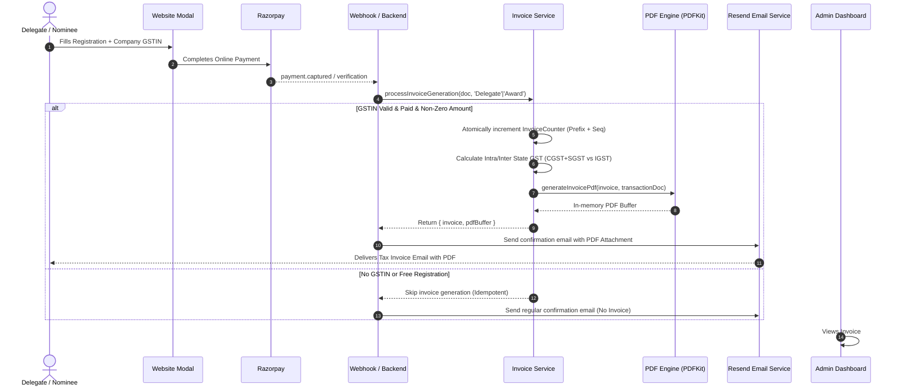

# 🧾 Comprehensive Invoice System Architecture & Email Delivery Documentation
**Brand R.Comm 2026 — 5th Agriculture & Rural Communication Summit & Awards**

---

## 📌 Executive Summary

The **Invoice System** in Brand R.Comm 2026 is an automated, GST-compliant financial document generation and email delivery pipeline. Whenever a participant (Delegate or Award Nominee) successfully completes a paid registration and has provided a valid Indian GST Identification Number (GSTIN), the system automatically:
1. Calculates **CGST + SGST (Intra-state)** or **IGST (Inter-state)** based on Indian tax rules.
2. Generates an atomic, sequential Tax Invoice number (e.g., `SIPLBRCOMM26-DEL-001` or `SIPLBRCOMM26-AWD-001`).
3. Saves a persistent [`Invoice`](file:///c:/Users/Asus/Desktop/Snail-integral/Brand-r-com-4/backend/src/models/Invoice.js) record in MongoDB.
4. Compiles a high-resolution, branded PDF Tax Invoice in-memory with official headers, stamps, and signatures.
5. Attaches the PDF to the automated confirmation email sent via **Resend** directly to the buyer's email address.
6. Surfaces the invoice in the **Admin Panel** with live PDF preview, direct download, and 1-click email resend capability.

---

## 🗺️ System Map: Where Invoices Exist Across the Entire Website

| Surface | Location / File | Purpose & UI Experience |
| :--- | :--- | :--- |
| **Frontend: Delegate Modal** | [`DelegateRegistrationModal.jsx`](file:///c:/Users/Asus/Desktop/Snail-integral/Brand-r-com-4/frontend/src/components/DelegateRegistrationModal.jsx#L959) | Form field `Company GST No. (optional for tax invoice)` allows buyers to input their GSTIN. |
| **Frontend: Flow Explanation** | [`RegistrationFlowSection.jsx`](file:///c:/Users/Asus/Desktop/Snail-integral/Brand-r-com-4/frontend/src/components/RegistrationFlowSection.jsx#L40) | Features Step 4: *"Invoice: GST-compliant invoice emailed upon payment confirmation."* |
| **Frontend: Award Nominations** | [`AwardNominationModal.jsx`](file:///c:/Users/Asus/Desktop/Snail-integral/Brand-r-com-4/frontend/src/components/AwardNominationModal.jsx) | Collects organization name, address, and GSTIN for award entries. |
| **Backend: Database Models** | [`Invoice.js`](file:///c:/Users/Asus/Desktop/Snail-integral/Brand-r-com-4/backend/src/models/Invoice.js) <br> [`InvoiceCounter.js`](file:///c:/Users/Asus/Desktop/Snail-integral/Brand-r-com-4/backend/src/models/InvoiceCounter.js) | Stores full tax breakdown, buyer details, payment ID, and atomic sequence counter. |
| **Backend: Core Service** | [`invoiceService.js`](file:///c:/Users/Asus/Desktop/Snail-integral/Brand-r-com-4/backend/src/services/invoiceService.js) | Handles GSTIN validation, state tax logic (09 UP vs Other), DB upsert, and idempotency. |
| **Backend: PDF Engine** | [`generateInvoicePdf.js`](file:///c:/Users/Asus/Desktop/Snail-integral/Brand-r-com-4/backend/src/utils/generateInvoicePdf.js) | Uses PDFKit to produce pixel-perfect A4 tax invoices with official stamps, headers, and footer banners. |
| **Backend: Email Dispatcher** | [`emailService.js`](file:///c:/Users/Asus/Desktop/Snail-integral/Brand-r-com-4/backend/src/services/emailService.js#L330-L405) | Attaches generated PDF to participant confirmation emails and dispatches via Resend. |
| **Backend: Webhooks & Controllers** | [`webhookController.js`](file:///c:/Users/Asus/Desktop/Snail-integral/Brand-r-com-4/backend/src/controllers/webhookController.js) <br> [`delegateController.js`](file:///c:/Users/Asus/Desktop/Snail-integral/Brand-r-com-4/backend/src/controllers/delegateController.js) <br> [`nominationController.js`](file:///c:/Users/Asus/Desktop/Snail-integral/Brand-r-com-4/backend/src/controllers/nominationController.js) | Triggers the invoice creation and email pipeline on Razorpay payment success. |
| **Backend: API Routes** | [`invoiceRoutes.js`](file:///c:/Users/Asus/Desktop/Snail-integral/Brand-r-com-4/backend/src/routes/invoiceRoutes.js) <br> [`invoiceController.js`](file:///c:/Users/Asus/Desktop/Snail-integral/Brand-r-com-4/backend/src/controllers/invoiceController.js) | Endpoints: `GET /api/invoices/:id/pdf` (download) and `POST /api/invoices/:id/resend` (resend email). |
| **Admin Panel: Dashboard** | [`delegates/page.jsx`](file:///c:/Users/Asus/Desktop/Snail-integral/Brand-r-com-4/admin/src/app/dashboard/delegates/page.jsx#L734) | Live table displaying Invoice Number, `[View PDF]` link, and invoice status tags. |

---

## ⚙️ How the Invoice Email System Works (Step-by-Step)



---

## 🔍 Detailed Component Breakdown

### 1. Qualification & Eligibility Conditions
An automatic tax invoice is generated **ONLY** when all four of the following criteria are met:
1. **Payment Status**: `paymentStatus === 'Paid'` (unpaid, failed, or pending transactions are ignored).
2. **Valid GSTIN**: The user submitted a valid 15-character Indian GST number matching the statutory regex:
   ```javascript
   /^[0-9]{2}[A-Z]{5}[0-9]{4}[A-Z]{1}[1-9A-Z]{1}Z[0-9A-Z]{1}$/i
   ```
3. **Non-Free**: Total amount paid > ₹0 (free/complimentary/guest passes do not generate tax invoices).
4. **Idempotency**: An invoice for the specific Razorpay payment ID (`razorpayPaymentId`) must not already exist in the database.

---

### 2. Tax Calculation Mechanics (GST Rules)
Handled in [`invoiceService.js`](file:///c:/Users/Asus/Desktop/Snail-integral/Brand-r-com-4/backend/src/services/invoiceService.js#L19-L35):
- **Supplier State Code**: Default `09` (Uttar Pradesh, Snail Integral / Brand R.Comm registered office, configurable via `SUPPLIER_GST_STATE_CODE`).
- **Buyer State Code**: Extracted from the first 2 digits of the buyer's GSTIN (e.g., `27` for Maharashtra, `07` for Delhi, `09` for UP).
- **Backward Tax Extraction**: Since payment prices are gross (inclusive of 18% GST):
  $$\text{Taxable Amount} = \frac{\text{Total Paid}}{1.18}$$
- **Tax Breakdown**:
  - **Intra-State (Buyer State == 09 UP)**:
    - `CGST (9%)` = `Taxable Amount * 0.09`
    - `SGST (9%)` = `Taxable Amount * 0.09`
    - `IGST` = `₹0.00`
  - **Inter-State (Buyer State != 09 UP)**:
    - `CGST` = `₹0.00`
    - `SGST` = `₹0.00`
    - `IGST (18%)` = `Taxable Amount * 0.18`

---

### 3. Numbering Sequence & Atomicity
Invoices use atomic MongoDB counters via [`InvoiceCounter`](file:///c:/Users/Asus/Desktop/Snail-integral/Brand-r-com-4/backend/src/models/InvoiceCounter.js) to guarantee zero gaps and zero duplicates even under heavy concurrent load:
- **Delegate Format**: `SIPLBRCOMM26-DEL-001`, `SIPLBRCOMM26-DEL-002`, ...
- **Award Nomination Format**: `SIPLBRCOMM26-AWD-001`, `SIPLBRCOMM26-AWD-002`, ...
- **HSN Code**: `998596` (Convention & Event Organisation Services).

---

### 4. PDF Generation Architecture
Engineered in [`generateInvoicePdf.js`](file:///c:/Users/Asus/Desktop/Snail-integral/Brand-r-com-4/backend/src/utils/generateInvoicePdf.js):
- Built using **PDFKit** to run completely in memory without temporary files on disk.
- Assets integrated:
  - **Header Banner**: Branded event title and organizer banner (`backend/src/assets/invoice/header.png`).
  - **Official Stamp & Sign**: Digital authorization stamp (`backend/src/assets/invoice/stamp.png`).
  - **Footer Banner**: Organizer contact details and company disclaimer (`backend/src/assets/invoice/footer.png`).
- Features Indian rupee number-to-words conversion (e.g., *"Seven Thousand Eighty Rupees Only"*).

---

### 5. Automated Email Delivery via Resend
Implemented in [`emailService.js`](file:///c:/Users/Asus/Desktop/Snail-integral/Brand-r-com-4/backend/src/services/emailService.js#L330-L425):

#### A. From Address Configuration
- Primary Sender: `process.env.RESEND_FROM_EMAIL || 'Brandrcomm <noreply@brandrcomm.com>'`
- Resend API Key: Loaded securely from `process.env.RESEND_API_KEY`
- Resend Resend Manual Endpoint Sender: `registration@events.brandrcomm.com`

#### B. Dynamic Subject Line
When an invoice is attached, the email subject updates automatically:
- Delegate: `✅ Registration Confirmed & Tax Invoice: BRAND R.Comm 2026 (<Participant Name>)`
- Award: `✅ Registration Confirmed & Tax Invoice: BRAND R.Comm 2026 (<Nominee Name>)`

#### C. Attachment Specifications
- Attachment Name: `Tax_Invoice_<BuyerName_Sanitized>.pdf`
- Format: Native PDF buffer directly attached to the Resend multipart payload.

---

### 6. Admin Panel Capabilities
Located at [`admin/src/app/dashboard/delegates/page.jsx`](file:///c:/Users/Asus/Desktop/Snail-integral/Brand-r-com-4/admin/src/app/dashboard/delegates/page.jsx):
1. **Invoice Column**: Displays the generated sequence number (e.g. `SIPLBRCOMM26-DEL-005`).
2. **Live PDF Inspection**: Clicking `[View PDF]` opens `GET /api/invoices/:id/pdf` directly in a new browser tab.
3. **Resend Invoice Action**:
   - Triggers `POST /api/invoices/:id/resend`.
   - Re-renders the PDF and emails it to the buyer with an updated notification message.
4. **Status Badges**:
   - Shows `Not Generated` if payment was completed but no valid GSTIN was supplied.
   - Shows `Not Applicable` if registration is pending or free.

---

## 🔒 Security & Data Integrity Safeguards

1. **Idempotency Guarantee**:
   - Re-running webhooks or payment confirmations never issues a second invoice number. The database checks `Invoice.findOne({ paymentId })` and returns the existing invoice.
   - Database unique index on `invoiceNumber` prevents race conditions.
2. **Reverse Reference Linking**:
   - `DelegateRegistration.invoiceId` and `AwardNomination.invoiceId` store the MongoDB `_id` of the generated invoice for instantaneous lookups.
3. **Graceful Degradation**:
   - If PDF generation or Resend email delivery encounters an unexpected error, the registration payment itself is **never rolled back or blocked**. The error is logged to error monitoring, and the invoice can be re-generated or resent from the admin panel at any time.

---

## 🛠️ Developer & Operational Reference

### Environment Variables Needed
```env
# Email Delivery
RESEND_API_KEY=re_xxxxxxxxxxxxxxxxxxxxxxxxx
RESEND_FROM_EMAIL=Brandrcomm <noreply@brandrcomm.com>

# Tax Configuration (Optional - Defaults to UP 09)
SUPPLIER_GST_STATE_CODE=09

# Admin Notification Receivers
ADMIN_NOTIFICATION_EMAILS=snailintegral2@gmail.com,shaurya098n@gmail.com
```

### API Endpoints Quick Reference
- `GET /api/invoices/:id/pdf` — Stream and download the generated PDF tax invoice.
- `POST /api/invoices/:id/resend` — Re-send the invoice PDF to the participant's email via Resend.
